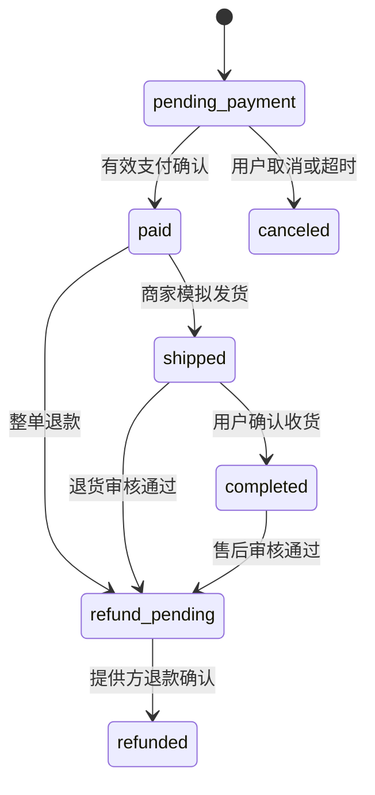

# 未来电商扩展备忘（不属于 v2）

2026-10-09：用户确定 v2 暂不实现电商。本文件仅保存 Draft 0.1 的研究构想，未获实施批准，不创建代码、表、路由、菜单或验收任务。未来启动电商时重新评审范围、状态机和支付方案。

当前只约束扩展边界，见 [v2 总体架构](../v2/02-architecture.md)。

## 历史构想：先把并发正确性做好

支持多个商家，但一张订单只属于一家店；购物车按店拆分结算。商品/SPU 与 SKU 分开，视频可关联多个已上架商品。买家不能自行给价格、折扣或运费；首版无优惠、运费采用简单固定规则并写入快照。

支付 attempt 和退款有独立状态，不把网络超时当作支付失败。订单 state 表达业务状态，payment attempt 表达与提供方交互状态。

### 下单、预占与回调

1. preview 返回价格与版本，用于确认页面；create order 按幂等键去重，并再次计算总价。
2. 在 commerce 单一事务内按 SKU ID 固定顺序锁库存，验证上架/价格版本/数量，再更新 reserved，写订单项快照、reservation、超时任务和 outbox。库存不足整单回滚；`on_hand - reserved ≥ quantity` 必须由 SQL 条件/约束保证。
3. 预占15 min。事务外由 PaymentProvider 创建支付尝试，使用稳定 merchant_payment_id；调用超时先查询该 ID，不能生成新 ID 盲目重试。
4. 回调验证签名、时间、防重放、商户号、订单、币种和金额；原始事件唯一入 webhook_inbox。拿订单锁，与超时/取消操作串行竞争。
5. 合法且未取消的支付成功：`pending_payment → paid`，reserved 减少、on_hand 同量减少；同一事务落库存流水和 outbox。重复回调只返回已处理结果。
6. 取消/超时：在订单锁下检查状态，仅 pending 释放预占并改 canceled。支付晚到而库存已释放时不自动复活订单，记录 late_paid 并创建幂等自动退款任务；失败报警和对账，不能既给货又退款。
7. 每日按 merchant_payment_id 对账提供方状态与本地 attempt。发现“外部成功、本地未知”走同一确认用例。

退款初期仅整单：退款成功前状态保持 pending，金额不能超已付；未发货退款成功后恢复库存；已发货必须模拟确认退货后才恢复可售库存。退款/退货状态分开记录，失败保留可重试和人工处理入口。

支付默认 `SandboxPaymentProvider`（项目内可控模拟器，可生成已签名回调并注入失败），统一接口至少有 CreatePayment、QueryPayment、Refund、QueryRefund、VerifyWebhook。它不处理真实资金。后续真实渠道需独立接入验证；浏览器跳转“支付成功”页面绝不作为 paid 依据。

验收：库存10件、100个并发不同订单，各买1件，最多10个预占成功；同一 key 并发100次只产生1单；支付回调与超时同时发生、重复回调、金额错误、提供方超时、退款重试都检查最终账实一致。

## 历史数据表草案

| schema | 表/关键字段 | 约束与索引设想 |
| --- | --- | --- |
| commerce | shops、shop_members、products、skus、video_products、carts、cart_items | sku 价格/库存非负；cart item 唯一；视频挂载商品经 content 所有权和 shop 权限校验 |
| commerce | inventory(sku_id,on_hand,reserved,version)、reservations(order_id,sku_id,qty,state,expires_at) | `0 ≤ reserved ≤ on_hand`；`(order_id,sku_id)` 唯一；库存流水有唯一业务操作 ID |
| commerce | orders、order_items、payment_attempts、refunds、shipments、webhook_inbox | 订单项固定名称/单价快照；provider_tx_id/provider_event_id 唯一；一张订单只能有一次成功支付 |

## 历史接口草案

| 方法/路径 | 关键请求/返回 | 权限与语义设想 |
| --- | --- | --- |
| GET /products、/products/{id}；PUT /cart/items/{sku_id} | 商品/购物车数量 | 购物车登录 |
| POST /checkouts/preview；POST /orders | 店铺、SKU/数量、报价版本；订单 | 最终下单重新校验价格；Idempotency-Key 必填 |
| POST /orders/{id}/payment-attempts；POST /orders/{id}/cancel | 支付尝试/状态 | 买家；只能按状态机改变 |
| POST /payments/webhooks/{provider} | provider 事件 | 原始 body 验签，不能依赖用户 JWT |
| POST /orders/{id}/refunds；POST /orders/{id}/confirm | 整单退款/确认收货 | 买家；幂等 |
