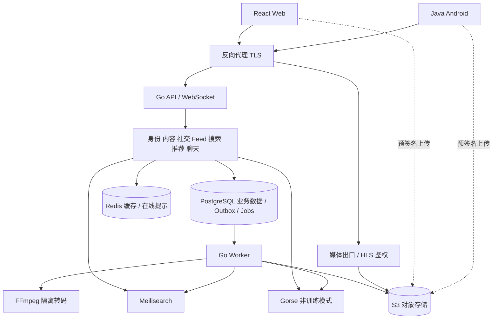

# 02 · 总体架构

## 1. 运行形态

**模块化单体的含义：业务按模块组织并约束依赖，核心业务作为一个应用构建和发布。** “模块化”描述代码与数据的边界，“单体”描述业务应用的部署边界，两者并不矛盾。

以闪映为例，用户、视频、社交、聊天分别拥有自己的业务规则与数据访问代码，由一个 Hertz API 应用组装。Feed 需要作者资料时调用用户模块的公开能力，而不是自己访问用户表。这个调用通常就是同进程的 Go 方法调用，不需要 HTTP/RPC。

| 维度 | 本项目的模块化单体 | 独立微服务方案 |
| --- | --- | --- |
| 代码组织 | 同一 Go 应用内，按业务分包并限制依赖 | 各业务有独立服务入口，代码仓库可合可分 |
| 模块通信 | 进程内接口调用；异步工作经持久化任务 | 跨进程 HTTP/RPC/消息通信 |
| 数据 | 初期同 PG 实例，各模块拥有自己的表/schema | 服务拥有独立数据边界，常需跨服务一致性设计 |
| 发布 | 核心业务统一构建、版本与发布 | 各服务可独立发布，但需协议兼容 |
| 扩容/故障 | API 通常整体复制，进程故障会影响多个模块 | 可分别伸缩与隔离，运维和网络故障处理更多 |

只创建几个目录不足以形成模块化。必须实际约束：其它模块不能直接改其表、不能导入其内部 repository、不能绕过其状态机。Hertz RequestContext 只在 HTTP adapter 出现，进入业务层时转换为普通参数和标准 context.Context。代码评审、导入规则和测试共同守住边界。

一份 Go 代码库，两个主要进程：`api` 与 `worker`。前者处理 HTTP/WebSocket，后者执行转码、索引同步、推荐数据同步和通知。两者共享业务模块与发布版本，按在线请求/后台任务分工；这是一种模块化单体加后台工作进程的方案，并非强制全系统只有一个进程。worker 按队列类型启动实例，转码可单独扩容，不要求先拆成独立服务仓库。

PostgreSQL、Redis、搜索引擎、对象存储本来就是独立进程，它们的存在不等于已经把用户、视频、聊天拆成业务微服务。Monorepo 仅表示仓库组织，也不决定采用单体还是微服务。

当前单人维护、自有本地服务器部署，统一构建调试和发布有利于控制成本。代价是核心业务不能完全独立发布和隔离故障；单体也可以运行多个 API 副本，但每个副本通常包含所有核心模块。之后拆出聊天仍需迁移数据、鉴权和通信协议，良好边界能降低难度，不能保证“零成本拆分”。



数据库是真实状态来源；搜索、推荐数据和缓存是可重建投影。媒体字节经过对象存储/媒体出口，普通业务 API 不承担视频下载流量。图中是逻辑职责，不代表必须为每个框启动一个容器。

## 2. 模块与数据所有权

| 模块 | 负责 | 对外能力 | 不负责 |
| --- | --- | --- | --- |
| identity | 账号、资料、角色、设备会话 | Authenticate、BatchPublicProfiles、Authorize | 视频/聊天业务 |
| content | 视频元数据、标签、发布/审核/下架 | Publish、BatchVisibleVideos、GetVisibility | 存储 SDK、推荐排序 |
| media | 上传会话、文件、转码产物、播放凭证 | CreateUpload、CompleteUpload、ResolvePlayback | 内容排序 |
| social | 关注、拉黑、点赞、收藏、评论及其统计 | BatchViewerState、GetFollowees、CanContact | 视频表修改 |
| discovery | Feed 组装、搜索入口、推荐编排、曝光行为 | GetFeed、Search、RecordFeedback | 修改内容和社交表 |
| messaging | 单聊会话、消息、已读和离线同步 | Send、Sync、AdvanceReadCursor | 将 WebSocket 连接当消息存储 |
| notification | 点赞/关注等系统通知 | List、MarkRead、PushHint | 替代聊天消息历史 |
| moderation | 举报、审核案件、审计 | ReviewCase、RequestTakedown | 直接改其它模块的表 |

`discovery` 内分 `feed/search/recommendation/behavior` 包。先保留清楚的子边界，不强制每个包一个服务。电商属于未来新增的 `commerce` 模块，不在 v2 模块清单中。

### 电商扩展边界（v2 不实现电商）

未来 commerce 可调用 identity 的身份/权限能力和 content 的视频归属/可见性能力，并拥有自己的商品、库存和订单数据。视频与商品的关联届时由 commerce 管理，当前 videos 表不加入 price、stock、order_id 等字段；现有模块不能依赖尚不存在的 commerce。

Feed 查询编排将来可以批量补充商品卡片；聊天协议设计采用 type + payload 的版本化结构，未来新增 product_card 类型时再定义其 schema、权限和客户端能力协商。v2 只支持 text/video_card，并拒绝未支持的发送类型；收到未知类型的旧客户端显示兼容占位。新增消息类型不等于接受任意 payload。

这轮仅保留上述依赖方向、公开业务能力和协议演进规则，不创建空 commerce 包、数据库表、支付接口或商城菜单。旧详细交易构想移到[未来电商备忘](../future/commerce-notes.md)，不作为已批准需求或 v2 验收项。

管理界面是这些业务能力的受权限保护入口，不是一个可绕过领域规则的“万能后台”。

## 3. 目录与依赖

以下是下一阶段目标结构，本轮不创建空壳应用：

```text
Shanying/
  apps/web/                     React 用户端与 /admin 路由
  apps/android/                 Java Android，多 Gradle 模块
  server/
    cmd/api/                    手工组装与启动
    cmd/worker/                 后台任务入口
    internal/modules/
      content/
        public/                 跨模块稳定 DTO、事件定义
        domain/                 状态、规则、实体，无框架依赖
        application/            用例、小接口、事务边界
        adapters/http/          HTTP 输入输出映射
        adapters/postgres/      SQL、sqlc 生成代码
      identity/ media/ social/ discovery/ messaging/ ...
    internal/platform/          数据库连接、任务基础设施、日志等
    internal/bootstrap/         显式依赖注入，跨域适配器
    migrations/                 全局有序数据库迁移
  contracts/
    http/openapi.yaml           HTTP 唯一契约来源
    realtime/                   WS JSON Schema 与示例
    events/                     内部事件 schema
    examples/                   三端共享的正反例
  packages/api-client-web/      生成的 Web SDK + 少量运行时封装
  deploy/                       Compose、代理、监控配置
  scripts/                      启动、生成、数据、验证工具
  tests/contract/ tests/e2e/ tests/load/
  docs/v2/ docs/adr/ docs/benchmarks/
```

依赖规则：adapter → application → domain；domain 不依赖 Hertz、SQL、Redis 或 SDK。接口由消费者定义，只为存在的边界定义，不给每个 struct 机械配一层接口。

跨域只能使用 `public` 类型与消费者接口。bootstrap 把 content 的公开能力注入 social/discovery，不能让 social 直接拿 content repository。domain 模型不直接用作 JSON 响应，sqlc 记录只在数据库 adapter 中使用。

唯一共享基础包容纳技术能力；禁止把视频状态、消息规则、通用业务实体塞入 `common/utils/base_service`。不引入万能 CRUD repository、运行时插件系统或全局 service locator。依赖检查用 golangci-lint 的导入约束加架构检查脚本，在 CI 阻止越界。

## 4. 同步调用与事务

需要即时结果的操作使用进程内调用；对外统一 REST/JSON 和 WebSocket。起步没有内部 gRPC，也不为每个模块模拟网络调用。

各模块拥有自己的表。允许通过公开接口做跨模块只读查询，不跨模块直接 JOIN 业务表；需要批量显示时提供批量查询或 discovery 自己的读投影。

点赞/评论的写入、计数与 outbox 在 social 事务内完成。发布前验证媒体任务成功；把引用的 media asset 视为不可变资源。视频下架与并发评论可以短暂竞态，但所有对外读取以内容可见性复核，不能因滞后事件暴露下架内容。

初期同一 PG 实例、各域独立 schema；域内保留 FK，跨域 ID 通过接口校验和修复任务维护。避免用跨 schema 触发器隐式改变其它域。域内计数优先显式事务更新，定期对账；SQL CHECK、UNIQUE 和行锁负责最后一道一致性约束。

## 5. 可靠异步：Outbox + PostgreSQL 任务

不在业务事务中同时写 PG、搜索引擎和推荐引擎。一个业务提交同时写 `platform.outbox_events`。分发器把事件展开为每个订阅者独立的 `event_deliveries`，唯一键 `(consumer,event_id)`；订阅者之间互不抢走任务。

worker 用 `FOR UPDATE SKIP LOCKED` 短事务认领 delivery/job，写入 lease owner、lease deadline 和 attempt，然后提交；长时间网络请求和转码都在事务外执行。完成时按 lease token 条件更新；过期 lease 可重领，旧 worker 不能确认新 worker 的结果。转码 lease 定期续租。

保证 **至少一次投递**。数据库内副作用与 `consumer_inbox` 去重记录同事务提交；外部副作用用稳定幂等键/版本覆盖，实现可安全重试。不宣称端到端 exactly-once。

失败策略：指数退避加随机抖动，默认最多 8 次；最终失败进入 dead 状态，保留原因和操作入口。重放保留 event_id，不能通过换 ID 绕过去重。关键指标包括积压数量、最老未处理时间、重试数、lease 超时和 dead 数。

事件可能乱序：投影携带 aggregate_version；对同一实体串行处理、使用最新主库状态构建投影。不可用“记录最后版本”代替对外写入顺序控制。Meilisearch 返回任务 ID 后还要确认 task succeeded，详见业务流程。

PG 队列适合当前规模，减少 Kafka/NATS 运维。真正需要独立队列时替换 transport adapter，保留事件协议、outbox 和消费幂等。PG 故障时不接受发布/消息等关键写入，不把数据暂存在 Redis 后假装成功。[PG 锁语义](https://www.postgresql.org/docs/17/sql-select.html)

## 6. 部署与资源假设

开发采用 Docker Compose；Windows 使用 Docker Desktop 的 Linux 容器/WSL2，生产构建和 CI 以 Linux 为基准。Web 构建为静态文件，反向代理同源暴露 `/api/v2`、`/ws`、`/media`，TLS 在代理终止。

建议 profile：`core`（PG、Redis、S3、api、worker、Web）、`discovery`（Meilisearch、Gorse）、`observability`（Prometheus、Grafana、OTel Collector、Tempo）。基础日志采用 JSON 输出到 stdout，首版不新增 Loki 集群。

server 明确部署在开发者自有本地服务器，不以采购云主机为前提。保留开发与验收文档中现有的 4 vCPU / 2 GB 测试机基线。P0 核实操作系统、CPU/内存、磁盘空间、外网可达方式与上行带宽，记录各进程 RSS、启动时间和转码峰值。

2 GB 下不得预先承诺全部组件和目标数据量同时运行。先限制转码并发为 1，关闭完整监控 profile，测量 core 再启用 discovery；若仍不足，记录容量限制，选择分时转码、把转码 worker 放在开发机或调整资源分配。Android 模拟器在开发机运行。只有所测组合能实际稳定运行时才进行性能验收，不能把不同配置的结果合并成一次全栈成绩。

初期内网访问，外网演示取决于服务器真实网络条件；反向代理、TLS、上传和媒体地址都必须对客户端可达，不能返回服务器内部容器地址。测试数据全部合成，媒体使用可复现生成的有效视频文件，无历史数据导入任务。

PG 和对象文件分别备份；Meilisearch/Gorse/Redis 可由业务数据重建。首版恢复目标 RPO ≤24 h、RTO ≤2 h，仅为演示环境目标，必须实际恢复一次后才能写入验收报告。

## 7. 按证据演进

| 信号 | 优先措施 | 再考虑 |
| --- | --- | --- |
| 转码影响接口时延 | 分离 worker 资源、限制并发、独立机器 | 独立媒体服务 |
| WebSocket 连接消耗 API 资源 | 增加 `cmd/realtime` 部署入口，共用消息能力 | 独立聊天服务 |
| 读查询吃满连接池 | 查执行计划、批量查询、索引、读缓存 | 只读副本和专用读模型 |
| 单 PG 任务队列影响在线业务 | 批量认领、分队列/实例、归档已完成任务 | JetStream/Kafka 迁移 ADR |
| 搜索能力超过现有引擎 | 固定中文查询集证明能力缺口 | OpenSearch adapter |
| 模块独立发布确有需要 | 验证其不直接访问其它域数据 | 独立服务与 gRPC |

任何拆分都要提供现有瓶颈测量、收益目标、回滚路径。
