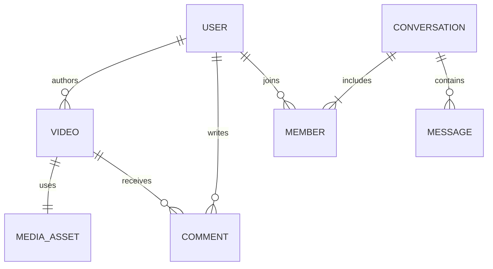

# 04 · 数据模型与接口约定

本文件给出逻辑模型和契约规则；完整可生成的 OpenAPI、SQL migrations、WS Schema 是 P0/P1 的代码交付物。本轮不将接口草案伪装为可运行 API。

## 1. 通用数据规则

- 业务 ID 用服务端生成的 UUID；数据库 uuid 类型，JSON 字符串。顺序依据显式时间/序号，不依赖 UUID 排序推断业务先后。
- 时间使用 `timestamptz`，传输 RFC 3339 UTC；界面转换到用户时区。
- 电商表、金额字段与交易接口不在 v2 契约中；未来加入时单独定义货币、精度与交易不变量。
- 消息序号、事件版本用 `BIGINT`，跨端 JSON 同样用十进制字符串。所有比较由明确的整数类型完成，不能按字典序比较序号。
- 每张业务表有主键和必要的 created_at/updated_at；需并发控制的聚合有 version。状态用受 CHECK 约束的 text，并通过状态机改变。
- 用户提供的字段必须有长度/数值限制。视频删除以业务状态表达；令牌等按保留策略物理清理。客户端不得传作者、消息发送者作为可信身份。

## 2. 核心表与约束

| schema | 表/关键字段 | 不可缺少的约束与索引 |
| --- | --- | --- |
| identity | users、profiles、roles、user_roles；sessions(id,user_id,device_id,refresh_hash,family_id,expires_at,revoked_at) | 用户名规范化唯一；refresh_hash 唯一；密码仅存慢哈希；会话可按用户/设备撤销 |
| content | videos(id,author_id,media_asset_id,title,description,publication_state,visibility,version,published_at)；tags、video_tags | 已发布视频要求 media_asset_id；绑定主 asset 的 ID 唯一；公开最新索引 `(published_at DESC,id DESC)` 带 published/public 条件 |
| media | upload_sessions(owner_id,object_key,multipart_id,state,expires_at)；assets；renditions(asset_id,profile,object_key,checksum) | object_key 唯一；`(asset_id,profile)` 唯一；会话归属不可转让 |
| social | follows、blocks、likes、favorites、comments、video_stats | `(follower,followee)` / `(user,video)` 唯一；禁止自关注；评论只能根/回复两级；统计非负 |
| discovery | behavior_events、feedback_state、content_projection、feed_exposures | event_id 去重；反馈按 actor/item/type 有当前状态；投影记录内容版本和删除 tombstone |
| messaging | conversations(id,pair_key,last_seq)、members(last_read_seq)、messages(seq,sender_id,client_message_id,payload) | 单聊规范化 pair_key 唯一；`(conversation_id,seq)` 唯一；`(sender_id,client_message_id)` 唯一 |
| messaging | user_inbox(user_id,event_seq,message_id,event_type) | `(user_id,event_seq)` 唯一；支持全会话离线增量同步 |
| notification | notifications(user_id,type,target_id,read_at,source_event_id) | `(user_id,source_event_id,type)` 唯一，按用户时间游标检索 |
| moderation | reports、review_cases、audit_logs | 管理操作带操作者、目标、前后状态、原因、request_id |
| platform | outbox_events、event_deliveries、consumer_inbox、jobs、idempotency_keys | 事件/消费唯一键；按可执行时间索引；幂等键包含 actor+operation+key |

关系图（箭头表达逻辑引用，不要求跨域建物理 FK）：



图中 VIDEO 与 MEDIA_ASSET 的一对一仅表示已绑定主视频；草稿可以尚未绑定，失败上传可没有视频引用。一个 asset 的封面和清晰度放在 renditions。

当前表清单与关系图不含电商。未来 commerce 拥有商品、库存、订单及视频商品关联表，见 [扩展备忘](../future/commerce-notes.md)。行为大表按时间归档；首版先普通表，达到查询/维护瓶颈再按月分区。若分区后无法跨分区保持 event_id 唯一，保留独立的短期去重表，不能静默失去幂等性。

## 3. HTTP 契约

基础路径 `/api/v2`。成功返回 `{data,meta}`；错误采用 HTTP 状态码加稳定业务 code：

```json
{
  "error": {
    "code": "VIDEO_NOT_READY",
    "message": "视频尚未处理完成",
    "details": {"video_id": "e379880f-e757-4d15-a466-3a8fd023b52a"}
  },
  "request_id": "req-example"
}
```

状态约定：400 输入格式，401 未认证/过期，403 已认证但禁止，404 不存在或不应暴露的资源，409 状态/幂等冲突，410 游标/会话已过期，413 超限，429 限流并带 Retry-After，503 依赖不可用。不要用 200 包装业务失败。未知错误不返回堆栈、SQL、令牌。

列表固定 `data.items`、`meta.next_cursor`、`meta.has_more`；没有元素用 `[]`。`limit` 默认 20，上限 50。最新/关注列表用 keyset；推荐、热门和搜索用 Redis 有期限的有序 ID 快照。cursor 签名并绑定 actor、过滤条件和版本，不能只 Base64 后信任。过期返回 `CURSOR_EXPIRED`，客户端新开会话。

推荐快照最多 500 个 ID，TTL 15 min；搜索快照最多 200 个 ID，TTL 5 min。游标位置按扫描过的候选推进，下架过滤后可以少于 limit；保证不会因为空页重复扫描同一片段。Redis 故障时明确切换最新流、返回新模式游标，不能拿推荐游标去执行时间分页。

## 4. 关键端点草案

| 方法/路径（省略 /api/v2） | 关键请求/返回 | 权限与语义 |
| --- | --- | --- |
| POST /auth/register、/auth/login、/auth/refresh、/auth/logout | 凭证、会话、access token | 匿名入口限流；refresh 轮换；logout 撤销当前设备 |
| GET /auth/csrf；POST /auth/mobile/login、/auth/mobile/refresh | Web CSRF token；移动端凭证/token DTO | Web 与移动端的 refresh 传输契约分开；身份规则相同 |
| GET/PATCH /me；GET /users/{id} | 私有/公开资料分开 DTO | 私有资料仅本人 |
| GET /sessions；DELETE /sessions/{id} | 设备列表/撤销 | 本人 |
| POST /uploads；POST /uploads/{id}/parts；GET /uploads/{id} | 元信息、分片号、短期签名、已上传分片 | 登录；对象 key 全由服务端生成 |
| POST /uploads/{id}/complete；DELETE /uploads/{id} | 分片清单、任务状态 | 归属校验；complete 幂等 |
| POST /videos；PATCH /videos/{id}；POST /videos/{id}/publish | upload_id、标题/标签；异步状态 | 作者；publish 幂等；服务端校验 asset 归属 |
| GET /videos/{id}；DELETE /videos/{id} | 视频详情/删除状态 | 可见性/作者校验 |
| POST /videos/{id}/playback | asset_version、有效期和播放地址 | 重新校验可见性；允许受限匿名播放 |
| GET /feed?mode=recommended/latest/following | 条目、cursor、strategy_version、session_id | following 需登录；匿名无画像 |
| GET /search/videos?q=... | 条目、快照 cursor、可选降级标识 | 主引擎失败返回明确不可用，不伪装全量中文搜索 |
| POST /behavior/batch | event_id、exposure_id、type、时长 | 单批≤100，逐项返回 accepted/duplicate/rejected |
| PUT/DELETE /videos/{id}/like、/favorite | 期望关系状态 | 登录；幂等 set/unset，不使用 toggle |
| POST /videos/{id}/comments；GET /videos/{id}/comments | body、parent_id；游标列表 | 写登录；读需内容可见 |
| PUT/DELETE /users/{id}/follow、/block | 关系状态 | 登录；禁止自操作 |
| POST /conversations/direct；GET /conversations | peer_id；会话 | 登录、拉黑/联系权限检查 |
| POST /conversations/{id}/messages | client_message_id、type、payload | 成员；REST 与 WS 共享 Send 用例 |
| GET /conversations/{id}/messages?before_seq=... | 历史消息 | 成员；历史倒序分页 |
| GET /sync?after=...；PUT /conversations/{id}/read | 用户全局同步 cursor；last_read_seq | 读游标只前进，不超过已存在序号 |
| POST /realtime/tickets；GET /ws | 一次性短期 ticket；WS 升级 | ticket 绑定 session 与 Origin |
| /admin/* | 审核、举报处理、任务重试 | 管理员角色 + 资源授权；随对应业务补齐逐项契约 |

管理员不能仅依靠隐藏菜单鉴权。内容管理、消息读取、媒体完成上传必须测试跨用户访问。

## 5. 认证与令牌生命周期

access token 初始有效期 10 min，JWT 固定算法与 issuer/audience，带 sub、session_id、exp、jti。refresh 为 256-bit 随机 opaque token，有效期 14 d，仅保存哈希。刷新在 PG 事务中锁会话、轮换；旧 token 重用则撤销该 family。客户端同设备合并刷新请求，失败后重新登录，不能无限重试。

Web 多标签页以 Web Locks 串行刷新，并用 BroadcastChannel 通知会话失效；不支持锁的浏览器发生刷新竞争时允许要求重新登录。移动端进程内使用单一刷新协调器。轮换响应丢失会导致持旧 token 的客户端重新登录，这是首版明确接受的可用性取舍，不通过长期接受旧 refresh 来规避重用检测。

Web：access 放内存；refresh 放 Secure/HttpOnly/SameSite=Lax Cookie，限制 Path `/api/v2/auth`；Cookie 端点校验 Origin 并使用 CSRF token。API 默认同源，开发走 Vite proxy。Web 认证响应不把 refresh 明文交给脚本。

Android：access 放内存；refresh 由 Android Keystore 中的密钥加密后保存应用私有文件，退出清除。移动认证使用 `/auth/mobile/login` 与 `/auth/mobile/refresh` 的独立 DTO 返回 refresh，不通过任意请求头切换浏览器安全策略；移动端退出调用公共 logout 并由 access 对应的 session 撤销。禁止把 client 类型当作信任级别，两端都执行相同身份/限流规则。

关键写请求和 WS 握手检查 session 是否撤销；Redis 仅作短缓存，故障回源 PG，无法验证则拒绝。普通读取允许已签发 access 在剩余有效期内存活；这与“立即撤销所有读取”不同，属于明确的取舍。WS 最长按 token/session 有效期重新鉴权；封禁后关闭已知连接，并在发送消息时再次验证。

## 6. 幂等与事件

视频创建、发布、上传完成要求 `Idempotency-Key`。记录 actor、operation、key、规范化 body hash、处理状态和资源 ID。并发相同 key 由唯一约束串行；相同 key 不同 body 返回 409。结果保存至少 24 h；上传会话与视频绑定唯一性长期保留，key 过期不能导致同一上传被重复创建视频。消息使用 client_message_id 达成独立幂等。

内部事件 envelope：

```json
{
  "event_id": "88362155-2c26-4611-9b3f-e7b9a369e6bf",
  "type": "content.video_published.v1",
  "aggregate_id": "7bc73b0b-b7a1-459f-b54e-e1e66ceba01c",
  "aggregate_version": "4",
  "occurred_at": "2026-10-09T08:00:00Z",
  "trace_id": "example-trace",
  "payload": {"video_id": "7bc73b0b-b7a1-459f-b54e-e1e66ceba01c"}
}
```

主要事件：`media.asset_ready/failed.v1`、`content.video_published/updated/hidden.v1`、`social.relation_changed.v1`、`messaging.message_committed.v1`。必要信息以业务事实表达；不要把整个数据库行、地址、令牌或聊天正文广播给不相关消费者。

小版本只添加可选字段，删除/改语义创建新版本并有兼容窗口。Android 已安装版本不能随服务端同时升级；未知字段忽略、未知枚举进入 fallback。接口变更必须在同一 PR 更新契约样例、生成代码和兼容说明。
