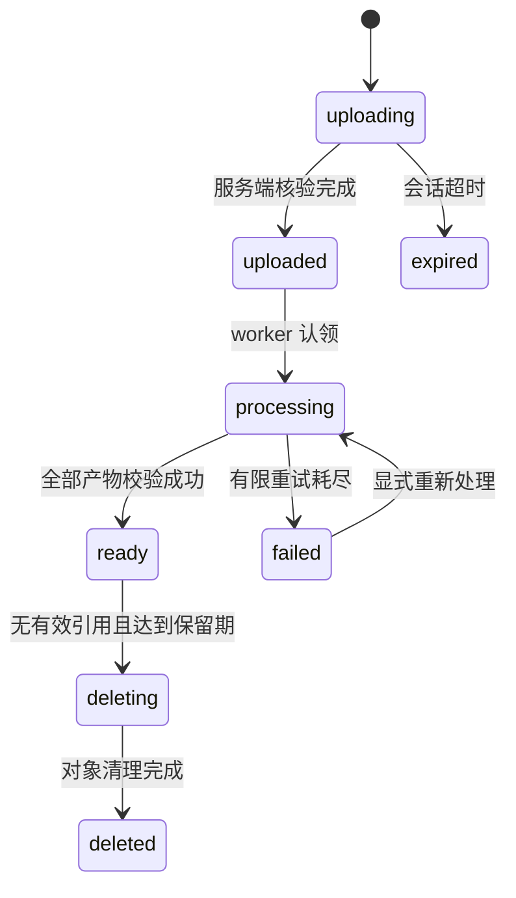

# 05 · 核心业务流程与失败恢复

本文件中的阈值是可配置初始值，必须通过验收调整；状态与一致性规则是实现约束。

## 1. 视频上传、处理与发布

媒体与内容分开建模，避免把“文件转码中”和“管理员下架”压进同一个数字 status。



内容状态独立：`draft → pending_review → published → hidden/deleted`，审核拒绝为 `rejected`，编辑后可重新提交；只有媒体 ready 才能提交审核。演示种子数据可受控自动审核，普通上传默认人工审核。下架不能被晚到的转码成功事件重新发布。

1. 登录用户申请 upload session。初始单文件≤200 MiB、时长≤180 s、最多5个标签；先做配额与类型声明校验。
2. 后端生成私有对象 key 和 multipart ID，按指定分片号签发短期上传地址。客户端只接触自己的会话，不提供任意 URL 让服务器下载。
3. 客户端分片上传并可查询恢复；服务端完成时核对归属、分片清单和 HEAD 大小。ETag 不当作完整文件 MD5。完成接口重复调用返回同一结果；对象已完成但数据库未提交时可通过 session/object_key 重新核验。
4. 一个 PG 事务写 asset 状态和转码 job。worker 拉取隔离目录，以非 shell 拼接参数运行 ffprobe/FFmpeg，限制 CPU、内存、磁盘、时间与协议输入，不允许转码器访问任意网络地址。
5. 提取真实宽高/时长/旋转，生成封面、faststart MP4 与 360p/720p HLS（不放大小源视频），H.264/AAC；无音轨时合法处理。HLS 初始分片 4 s，所有码率 GOP 对齐。
6. 产物写不可变版本目录，逐项校验后再提交 ready 和事件。认领 generation/lease token 一并校验，旧任务产物不能覆盖新版本；失败目录通过清理任务回收。
7. 作者完成标题/标签并提交审核；审核发布事务写 published 和 outbox，随后触发搜索/推荐同步。

对“上传到 S3 成功，但数据库失败”不承诺跨系统原子性；用不可变对象键、幂等完成、重查和孤儿扫描收敛。上传 session 初始 TTL 24 h，定期 abort 未完成 multipart；已完成无引用文件有宽限期，删除任务执行前重新确认引用和状态，避免删掉刚绑定的文件。

### 播放与下架

Web 使用 hls.js/原生 HLS，Android 使用 Media3。返回播放 session 与有效期。不能只签名 master.m3u8 而让子 playlist/分片永久公开。

演示部署由媒体出口校验短期签名路径和内容版本，重写 playlist 中的子资源路径并覆盖全部分片；校验通过后由代理从私有对象源取字节。媒体出口缓存 authorization 最长 30 s，凭证初始 5 min。下架更新版本并失效缓存，目标≤30 s 阻止新分片读取；已经下载到客户端的数据无法收回。扩展 CDN 时需对等支持整套 HLS 鉴权和失效，不只是替换域名。

验收包含：同一视频横竖屏、无音轨、损坏文件、重复完成、转码中杀进程、重试期间删除、下架后旧 URL、低带宽首帧与连续滑动。

## 2. 搜索：索引是投影

索引 `videos_vN` 字段为 video_id、title、description、tags、author_display_name、published_at、统计快照；只索引允许公开检索的内容，不存私有资料。初始字段优先级 title > tags > description > author，分类/时间为 filters，发布时间为可选 sort。

Meilisearch 自身的相关性规则负责排序，不把它描述为已采用 BM25 的 OpenSearch。中文分词能力由官方文档支持，领域词、混合英文、拼写错误的实际效果由测试决定。[分词](https://www.meilisearch.com/docs/capabilities/indexing/advanced/tokenization)

`video_published/updated/hidden` 消费者按 video 串行同步；忽略过期事件时仍以数据库最新状态为准。提交更新后保存 task UID，轮询到 succeeded 才确认 delivery。超时先查询已有 task，不能把“HTTP 接收成功”当作“索引已生效”。同一文档上一任务未确认时，不发布下一状态；故障恢复时重读主库并最终覆盖旧数据。[异步任务](https://www.meilisearch.com/docs/capabilities/indexing/tasks_and_batches/async_operations)

查询时先取有限 ID 快照，再批量回源 content 校验 published/public 及访问规则。下架必须在查询响应处立即过滤，不能只依赖索引最终删除。作者改名等事件明确触发其公开投影重建；不要绕过边界 JOIN 用户表。

重建流程：记录持久化变更水位 → 全量扫描主库 → 新索引接收扫描期间变更并追平 → 校验数量/样本 → 原子切换索引 → 暂留旧索引用于回滚。写入切换点有短暂同步屏障或双写投影，避免切换窗口漏更新。索引不可用时返回 SEARCH_UNAVAILABLE，页面可展示独立热门内容，不能把它当搜索命中。

目标索引延迟 p95≤10 s；每次至少测100条中文查询，其中包含多义词、专名、短词、中英混合和零命中。人工相关性标签用于评估，不用于训练模型。

## 3. 推荐：成熟组件，完全不训练

采用 **Gorse 标签相似 item-to-item 候选 + Go 业务策略**。标签和行为更新属于数据/相似度统计，不进行模型拟合、训练、微调或超参数搜索；v2 首版不需要 embedding 服务。将来如接预训练模型，仅做离线推理并另写 ADR。

Gorse 的官方说明分别支持 tags 候选、关闭 collaborative、关闭 ranker；不能只关闭 collaborative 却保留默认 FM ranker。[标签推荐](https://gorse.io/docs/concepts/recommenders/item-to-item) · [配置](https://gorse.io/docs/config) · [排序](https://gorse.io/docs/concepts/ranking)

下面是需要在锁定版本中验证的**配置片段**，不是完整可部署配置：

```toml
[recommend.collaborative]
type = "none"

[recommend.ranker]
type = "none"
recommenders = ["item-to-item/similar_topics", "latest"]

[[recommend.item-to-item]]
name = "similar_topics"
type = "tags"
column = "item.Labels.topics"
```

完整配置另含数据库、反馈类型、缓存周期、鉴权和资源限制。Gorse 使用同 PG 实例中的独立数据库/角色，不直接读取业务表；标签和当前反馈通过 adapter 同步。默认以 gorse-in-one 运行在内网，不能公开管理端或写 API。

### 候选与混排

Feed application 并行读取四路候选，上限各200：Gorse 个性标签近邻、过去7天热度、新发布内容、关注作者。候选仅为 ID/rank，不把引擎分数直接跨来源相加。

初始每20条目标配额为10相似 + 4热门 + 4新内容 + 2关注；空缺先由新内容/热门补足，全部不足时返回真实不足。交错输出并限制相邻同作者、单页同作者≤2、单一标签占比软上限50%；过滤已删除/下架/拉黑、重复候选、本人明确“不感兴趣”。软多样性规则可在低供给时放宽，权限规则永远不放宽。配额属于待评估基线，不称为最优算法。

热度使用最近7天去重有效播放/点赞/收藏等统计及发布时间衰减。例如 `log1p(valid_plays + 3*likes + 5*favorites) / pow(age_hours + 2, 0.8)`；配置与代码版本一同记录。每分钟重算候选榜；这是业务启发式公式，不是训练出的参数。

冷启动：匿名用户走热门+新内容；新注册用户可以选兴趣标签，尚无正反馈时按标签取候选；新视频审核后分配探索位置，不必等待互动。Gorse 超过100 ms预算或不可用时用本地候选降级，响应记录 `fallback_reason`。推荐请求总预算300 ms为设计目标。

### 曝光与反馈

服务端下发不等于曝光；客户端至少50%可见持续1 s才报告 impression。有效播放初值为播放≥2 s，短片按比例规则处理；完整播放按时长比例≥90%。duration/play_ms 取合理边界，后台与不可见页面不累计。客户端信息可被伪造，因此要按设备/账号限频、校验 exposure_id，不把它当可信权限或审核事实。

每条上报带 event_id、exposure_id、feed_session_id、strategy_version、video_id、device/session、发生时间和实际播放时长。离线晚到≤24 h可入统计，但不追改已经发出的快照；超出窗口拒绝并记录原因。点赞/收藏等强正反馈由业务事务产生，客户端不另造一份事实；取消动作撤销对应当前反馈。

行为先批量持久化，再由聚合任务投影到 Gorse。最近曝光集合采用 Redis 有界集合（初始7 d/每人最多2000个）并由持久事件补建；同会话始终去重。投影延迟时使用本地实时负反馈/下架过滤。不会因为 Gorse 落后而再次展示已拉黑内容。

### 评估与陈述边界

当前全部使用合成数据。固定素材集、行为时间切分、候选池、策略版本、随机种子。用历史前缀构造反馈，未来窗口作评价，避免把将来的点赞放回画像；合成数据和真实用户数据分开报告。

比较 latest、hot、Gorse+混排三组：Recall@20、NDCG@20（有可解释标签时）、覆盖率、多样性、重复率、冷启动覆盖、p95延迟和降级率。没有线上随机实验和足够样本时，不写“提升用户留存/CTR”。v2 验收要求链路正确、结果可复现、指标如实公布，不保证某策略一定优于基线。

## 4. 聊天：持久化在前，连接投递在后

v2 支持一对一文本、视频卡片；商品卡片留作未来扩展，系统通知和聊天消息独立建模。接收者允许联系且双方未拉黑才可发送；卡片展示时重新检查目标资源的可见性，内容失效显示占位。

消息通过 WS `message.send` 或 REST 调用同一 Send 用例。事务锁 conversation 行，校验成员和状态，递增 last_seq，插入 message、两方 user_inbox 与 outbox；提交后才向发送者返回 `message.ack`。这是“服务端已持久保存”，不是“对方已读”。

客户端生成持久 client_message_id。同用户重复 ID、相同 payload 返回原 message_id/seq；不同 payload 返回冲突。每个会话顺序由 seq 确定，无跨会话全局顺序承诺。user_inbox 为每用户单独分配 event_seq，用于断线后跨会话补拉。

user_inbox 使用用户同步计数行在同一事务内分配序号，锁顺序固定为 conversation → 按 user_id 排序的计数行，避免双方并发聊天死锁；同步读取只推进到已提交事件，不能用一个可能先分配后提交的全局sequence作为无遗漏游标。事务死锁/序列化失败只做有界重试，并复用client_message_id。

WebSocket envelope 初值：`{v:1,type,request_id,payload}`；事件包括 hello、message.send、message.ack、message.new、receipt.read、sync.required、error。帧≤16 KiB，文本≤2000字符，连接有发送队列上限、速率限制、25 s心跳和退避重连；慢连接主动断开并通过 sync 恢复，不无限堆内存。

多 API 实例用 Redis Pub/Sub 通知在线连接有新消息；它只有提示用途。Pub/Sub 丢消息时由 PG user_inbox 修复：客户端每30 s前台增量同步，服务端发现序号缺口通知 sync.required，重连/切回前台必须补拉。消息按 message_id 去重，未确认的本地消息使用原 ID 重发。Redis Pub/Sub 的投递语义不能支撑持久聊天本身。[官方语义](https://redis.io/docs/latest/develop/pubsub/)

已读游标采用 `max(old,new)`，上界校验为该会话最后持久消息；跨设备共享。未读数按接收方向、read cursor 与可见消息计算，不简单用 last_seq 相减。user_inbox 初始保留30 d，游标太旧返回 SYNC_RESET_REQUIRED，客户端重新同步会话摘要和所需历史；消息本体的保留策略独立。

浏览器用登录 API 换一次性30 s ticket，再建立 WS；ticket 绑定 session 和允许的 Origin，原子消费，代理日志屏蔽 ticket。Android 同样可用该流程。Android 后台不承诺长连接可靠驻留；本轮验收为前台实时和离线恢复，系统推送是后续扩展。

验收：提交后、ACK前杀 API；离线期间消息入库；Redis断开；乱序/重复提示；发送后立即拉黑；旧 ticket 重放；双设备读游标竞争。最终历史唯一、有序且不可越权。
